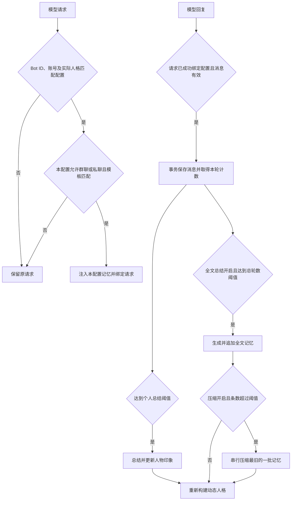

# PersonaFlow（人格关系流）1.2.3

[](https://github.com/AstrBotDevs/AstrBot)
[](https://github.com/yizyin2/astrbot_plugin_PersonaFlow)

PersonaFlow 为 AstrBot 提供人物印象、全文记忆和自动压缩功能。一个插件可以服务多个 Bot 和多个人格：按“Bot 唯一 ID + 人格名称 + 可选的机器人账号 ID”配置独立数据库、记忆和生效范围，使新会话继续使用对应的持久记忆。

## 主要功能

- **多 Bot / 多人格隔离**：按 Bot 唯一 ID、实际人格及可选的账号 ID 选择数据库；人物印象、聊天记录、对话计数、全文记忆和动态人格分别保存。
- **独立生效范围**：每个组合有自己的群号白名单和私聊开关；同一组合内的获准会话共享记忆。
- **人物关系与印象**：按每位用户的对话次数触发总结，使用用户 ID 保存，可在同一组合内跨群沿用。
- **全文总结**：按同一组合内所有生效会话的累计对话次数生成记忆，每次追加一条 Memory。
- **灵活注入**：支持 `{Impression}` 和 `{Memory}` 占位符；缺少占位符时，对应内容追加到人格末尾。
- **全文总结总开关**：关闭后停止生成和使用全文记忆，保留已有 Memory 数据，人物印象功能继续工作。
- **可配置压缩**：自定义压缩触发条数和每批条数，将最旧的一批记忆合并成一条；压缩结果可以再次参与压缩。
- **保留框架提示**：只替换请求中匹配的原始人格段，保留其他插件、技能和工具提示。
- **人格修改自动生效**：每次请求使用 AstrBot 当前的人格模板组装已有记忆，保存人格后下一条请求即可生效，无需重载插件。
- **并发保护**：消息保存与计数读取使用同一事务；记忆压缩串行执行，并在提交时校验待替换记录。

## 安装与启用

1. 将插件目录放入 AstrBot 的 `data/plugins/astrbot_plugin_PersonaFlow/`，或通过插件管理安装本仓库。
2. 重启 AstrBot 或重载插件，并在管理面板启用 PersonaFlow。
3. 在插件配置的 `memory_profiles` 中添加“Bot + 人格记忆配置”，填写机器人管理中的 **Bot 唯一 ID** 与已有的 **人格名称**。多个机器人账号共用一个适配器时，还需分别填写 **机器人账号 ID**。
4. 为每条配置分别填写群号列表，并按需开启私聊。数据库路径可留空，插件会自动创建独立数据库。
5. 在目标会话中实际选用对应人格，保存配置并重载插件。管理员可执行 `/osn profile` 检查当前匹配结果。

修改插件配置后需要重载。日常编辑并保存 AstrBot 的原始人格提示词后，下一条请求会自动使用新模板，不需要重载插件。

## 多 Bot / 多人格配置

`memory_profiles` 非空时启用多配置模式，按 Bot ID、实际人格和可选的账号 ID 选择条目。未匹配的组合不记录、不注入，不会回退使用旧库。同一个 Bot 可添加多个人格；同一个人格也可分别配置给多个 Bot。

| 条目字段 | 默认值 | 说明 |
| --- | --- | --- |
| `platform_id` | `""` | **必选**，在配置面板中从已配置的 Bot 列表里选择（即 AstrBot 机器人管理中的 Bot 唯一 ID）。列表在插件加载时生成，新增 Bot 后重载插件即可看到。 |
| `personas_name` | `""` | **必选**，在配置面板中从 AstrBot 已有人格列表里选择；会话必须实际选用该人格。 |
| `bot_self_id` | `""` | 可选，精确匹配 `event.get_self_id()` 返回的机器人账号 ID，例如机器人 QQ 号。留空匹配此适配器下的所有账号；多个账号共用适配器时，必须逐个填写以隔离记忆。 |
| `database_path` | `""` | 留空时按 Bot ID、人格名称及所填账号 ID 生成稳定路径，保存在 `data/plugin_data/astrbot_plugin_PersonaFlow/profiles/`。自定义时建议填写绝对路径。 |
| `apply_to_group_chat` | `[]` | 本组合生效的群号列表；空列表表示全部群聊，支持独立会话模式。 |
| `enable_private_chat` | `false` | 是否允许本组合在私聊中记录和注入；与群聊列表独立。 |

例如，下面为两个 Bot 配置三个独立数据库，假设每个适配器只接入一个机器人账号。请将 Bot ID、人格名称和群号替换成实际值；`__template_key` 是配置面板使用的模板标识，面板新增条目时会自动填写。

```json
{
  "memory_profiles": [
    {
      "__template_key": "profile",
      "platform_id": "bot_a",
      "personas_name": "小周周",
      "bot_self_id": "",
      "database_path": "",
      "apply_to_group_chat": ["123456789"],
      "enable_private_chat": false
    },
    {
      "__template_key": "profile",
      "platform_id": "bot_a",
      "personas_name": "工作助手",
      "bot_self_id": "",
      "database_path": "",
      "apply_to_group_chat": ["987654321"],
      "enable_private_chat": true
    },
    {
      "__template_key": "profile",
      "platform_id": "bot_b",
      "personas_name": "小周周",
      "bot_self_id": "",
      "database_path": "",
      "apply_to_group_chat": [],
      "enable_private_chat": false
    }
  ]
}
```

这三个配置之间不共享记忆，即使用户 ID、群号或人格提示词相同也不会混用。每个配置内部获准的群聊共享人物印象、全文记忆和计数；开启私聊后，私聊也加入同一配置的共享范围。群号白名单是生效范围，不会继续按群拆分数据库。

**多个账号共用一个适配器时**，例如 OneBot 接入的两个 QQ 机器人共用 `platform_id: "onebot_shared"`，应分别添加 `personas_name: "小周周", bot_self_id: "100000001"` 和 `personas_name: "小周周", bot_self_id: "100000002"` 两条配置，并将两条 `platform_id` 都填为 `onebot_shared`。请用真实账号 ID 替换示例数字。此时不能再为相同 `platform_id` 与人格添加 `bot_self_id: ""` 的条目，因为空值会匹配这两个账号，造成范围重叠。账号 ID 留空不会自动按实际账号拆分数据库。

人格选择遵循 AstrBot 的会话强制人格、当前对话人格和默认人格配置，不能仅靠相同的提示词匹配。请求钩子成功匹配配置和人格模板后，才会绑定该配置供对应回复保存；处理中切换人格不会把本轮回复写入另一配置。未成功匹配的请求，以及未经过该请求钩子成功绑定的第三方请求，其回复不会写入记忆数据库。

`platform_id + personas_name + bot_self_id` 三项相同的配置不能重复。同一 Bot ID 和人格可以使用不同的非空账号 ID，但不能同时存在空账号 ID 与指定账号 ID 的配置。不同条目不能指向同一个数据库文件。

自动路径由 Bot ID、人格名称及所填账号 ID 决定，调整列表顺序不会改变路径；修改这些字段会使用另一条自动路径。账号 ID 留空时沿用 Bot ID + 人格名称的路径规则。需要沿用原库时，应在修改前记录 `/osn profile` 显示的路径，并在新条目中明确指定它。

### 从旧版单库迁移

1. 停止 AstrBot 后备份旧数据库；如存在同名 `-wal`、`-shm` 文件，一并保留。旧版默认库为 `data/plugin_data/astrbot_plugin_PersonaFlow/OSNpermemory.db`，自定义路径以原配置为准。
2. 更新插件并启动 AstrBot。先保持 `memory_profiles: []`，旧版顶层人格、群聊范围和数据库路径会继续生效。
3. 添加需要隔离的 Bot + 人格条目；多个机器人账号共用一个适配器时，分别填写 `bot_self_id`。若要保留旧记忆，将旧数据库的**绝对路径**填写给其中**一个**条目；其余条目留空以使用新库。已有混合记忆不会自动拆分。
4. 分别设置群聊列表和私聊开关，保存并重载插件。`memory_profiles` 非空后，顶层 `personas_name`、`database_path`、`apply_to_group_chat` 不再参与路由。
5. 在各 Bot 和人格对应的会话中以管理员身份运行 `/osn profile`、`/osn checkmem`，确认命中的数据库及记忆。

插件不会自动复制、移动或删除旧库，数据库表结构无需迁移。若清空 `memory_profiles`，会恢复使用顶层旧版配置；各独立数据库仍保留在原处，不会自动合并回旧库。

## 配置说明

下表为插件默认值，已有安装以管理面板中保存的配置为准。

| 配置项 | 类型 | 默认值 | 说明 |
| --- | --- | --- | --- |
| `memory_profiles` | Template List | `[]` | Bot + 人格配置列表；为空时使用下列旧版单库配置。 |
| `personas_name` | String | `""` | 仅旧版单库模式生效：需要使用记忆的已有 AstrBot 人格名称。 |
| `summary_trigger_threshold` | Int | `5` | 同一数据库内每位用户累计多少轮有效对话后触发人物印象总结。 |
| `summary_history_count` | Int | `20` | 人物印象总结读取该用户最近多少条对话记录。 |
| `apply_to_group_chat` | List | `[]` | 仅旧版单库模式生效：生效群号列表；为空时允许全部群聊和私聊，非空时只允许指定群聊。 |
| `database_path` | String | `null` | 仅旧版单库模式生效：留空时使用 `data/plugin_data/astrbot_plugin_PersonaFlow/OSNpermemory.db`。 |
| `summary_max_retries` | Int | `3` | 模型总结的最大尝试次数，包含首次调用。 |
| `enable_memory_summary` | Bool | `true` | 全文总结总开关，同时控制生成、注入及向人物印象总结提供全文记忆。 |
| `summary_memory_trigger_threshold` | Int | `20` | 同一数据库内所有生效会话累计多少轮有效对话后触发一次全文总结。 |
| `summary_memory_history_count` | Int | `30` | 全文总结读取同一数据库内所有用户最近多少条对话记录。 |
| `enable_memory_compaction` | Bool | `true` | 是否在新增全文总结后检查并执行自动压缩。 |
| `memory_compaction_threshold` | Int | `30` | Memory **超过**此条数时触发压缩，等于时不压缩；至少为 2。 |
| `memory_compaction_batch_size` | Int | `20` | 每次将最旧的多少条记忆合并成一条；至少为 2，且不超过压缩阈值。 |

总结阈值、重试次数和功能开关为全局设置，所有条目共用这些参数，但各数据库独立累计计数、生成总结和执行压缩。旧版单库模式会让所有匹配人格的 Bot 共用一个数据库；需要隔离时请填写 `memory_profiles`。

压缩参数无法转换为整数或小于 2 时，会回退为各自默认值；批量大于阈值时按阈值执行。全文总结的“对话轮数”和压缩的“Memory 条数”是两种不同的计数。

例如，以下配置表示每 50 轮有效对话生成一次全文总结，超过 30 条 Memory 后，每次压缩最旧的 20 条：

```json
{
  "enable_memory_summary": true,
  "summary_memory_trigger_threshold": 50,
  "summary_memory_history_count": 50,
  "enable_memory_compaction": true,
  "memory_compaction_threshold": 30,
  "memory_compaction_batch_size": 20
}
```

## 人格提示词与占位符

可在原始人格中指定记忆的插入位置：

```text
你是一个叫“小周周”的 AI 助手，性格活泼可爱。

你认识的人：
{Impression}

以前的聊天记忆：
{Memory}

请根据这些关系和记忆，用符合人设的语气回答。
```

- `{Impression}`：替换为当前组合数据库中全部已保存的人物关系与印象；没写时追加到人格末尾。
- `{Memory}`：全文总结开启时替换为当前组合数据库中全部已保存的 Memory；没写时，将已有记忆追加到人格末尾的“历史对话记忆”段落。
- 没有 Memory 且没写 `{Memory}` 时，不追加空段落；显式占位符在暂无记忆时显示“暂无记忆总结。”。
- 全文总结关闭时，清空动态提示词中的 `{Memory}`，不再追加记忆，也不再将 Memory 提供给人物印象总结。已有数据保留，重新开启并重载插件后可恢复使用。

插件每次从原始人格模板重新构建动态版本，不会反复堆叠追加段落。注入时保留框架的其他系统提示；如果非空请求中找不到匹配的人格模板，会跳过替换。因此请让会话实际使用相应条目 `personas_name` 对应的人格。

保存原始人格修改后，后续聊天请求、人物印象总结、全文记忆总结和压缩都会从 AstrBot 当前的内存模板重新组装系统提示词，保留当前数据库已保存的人物印象和 Memory。这个刷新过程不调用模型，只有内容变化时才更新插件数据库。全文记忆总结和压缩的具体任务要求放在用户提示词中。已发出的请求和已有会话历史不会被重写。

如果人格在请求组装过程中发生修改，本次保留原请求，下一条请求使用新模板。同一请求已注入的人格段仍然存在时，重复执行注入不会追加第二份记忆；中途新增的记忆从下一条请求开始使用。

## 全文记忆生成

达到 `summary_memory_trigger_threshold` 后，插件从当前独立数据库的 `Message` 表读取最近 `summary_memory_history_count` 轮对话，按时间从旧到新传给当前会话的模型；每轮包含用户消息和模型回复。历史不足 N 轮时使用实际条数，无历史时跳过。

总结请求的系统提示词沿用当前聊天人格，使用最新模板及当前数据库的人物印象和 Memory 重新组装。总结任务要求和最近 N 轮历史放在用户提示词中，明确要求整理记忆并输出第三人称总结。上下文消息列表保持为空，所需历史由任务数据明确提供；已有 Memory 用于理解背景和去重。记忆压缩同样沿用当前聊天人格作为系统提示词。

模型需返回含非空 `summary` 字段的 JSON 对象，插件校验后只将该字段的纯文本写入 Memory。普通回复、原样照抄的对话或回复、空结果和模型错误会重试；用尽 `summary_max_retries` 后不追加记忆，也不会把当前聊天回复作为替代内容保存。后续正常请求仍按人格模板注入已有记忆。

更新后重载插件即可使用新的总结流程；此前已保存的 Memory 不会自动改写。

## Memory 自动压缩

1. 一次全文总结成功生成并进入保存流程后，检查自动压缩开关及 Memory 条数。
2. 超过 `memory_compaction_threshold` 时，读取最旧的 `memory_compaction_batch_size` 条记录。
3. 调用当前会话的模型，将这一批记录合并成一条总结。
4. 模型返回有效非空内容后，在事务中替换原记录。并发任务串行执行，过期批次不会再次写入；压缩失败时保留原记录。

默认的 `30 / 20` 配置下，**31 条记忆会变成 12 条**：一条压缩总结和最新的 11 条原始记忆。每次触发只处理一批；插件启动时不会单独执行压缩。将两个参数都设为 `10` 可恢复原来的固定条数行为。

压缩结果获得新 ID，但继承被压缩批次中最旧记录的时间。读取时按时间、ID 排序，因此通常保留在旧时间位置；相同时间戳的记录仍会按 ID 排序。压缩结果仍是普通 Memory，可以再次压缩。

压缩限制的是记录数量，不是字数或 Token 数。模型压缩会概括内容，多次压缩可能逐渐省略细节。

## 命令

| 命令 | 作用 |
| --- | --- |
| `/osn profile` | 查看当前 Bot ID、机器人账号 ID、实际人格、数据库路径、运行模式及当前会话是否允许记录和注入；未匹配时帮助定位配置。 |
| `/osn check [页码]` | 分页查看当前组合数据库中的人物印象、关系和对话次数，默认第 1 页。 |
| `/osn checkmem [页码]` | 分页查看当前组合数据库中的 Memory 内容及记录时间，默认第 1 页。 |
| `/osn del <用户ID>` | 删除该用户在当前组合数据库的 Impression、Message 表中的记录，并尝试刷新动态人格。 |

查询每页正文最多 1000 字符，并显示总页数与下一页命令，例如 `/osn checkmem 2`。单条超长记忆也会跨页显示，不会截断删除。查询不会修改数据库；两次翻页之间若数据库新增、压缩或删除了内容，页数和边界可能变化。OneBot / NapCat 上直接发送普通短文本，避免长消息自动合并转发时的上传失败。

`/osn del` 不会清理 Memory 总结中已经包含的该用户信息，也不会删除 AstrBot 自身的会话历史。`/new` 或 `/reset` 可以重置会话上下文，但不会清空插件的 Memory。

以上命令仅允许 **AstrBot 管理员**使用，群聊和私聊均会校验。管理员身份使用 AstrBot 的 `event.is_admin()` 判定，请在 AstrBot 配置的管理员 ID 列表（`admins_id`）中添加账号；仅有群主或群管理员身份不会自动获得权限。普通用户调用时会收到权限不足提示，指令不会读取或删除数据库内容。

命令不受当前配置 `apply_to_group_chat` 和 `enable_private_chat` 的记录与注入范围限制，但只选择当前 Bot、账号 ID 与实际人格对应的数据库，不支持用命令参数切换到其他组合。需要管理另一组合时，请到对应 Bot 的会话中切换为该人格后执行。旧版单库模式下，匹配旧版人格的会话操作旧库。

## 供其他插件调用的接口

其他插件可以读取 PersonaFlow 的人物印象，选库规则与聊天注入完全一致：按实际人格、Bot ID、账号 ID 选择数据库，并遵守群聊和私聊的生效范围。

```python
metadata = self.context.get_registered_star("astrbot_plugin_PersonaFlow")
personaflow = metadata.star_cls if metadata and metadata.activated else None
if personaflow is not None and getattr(personaflow, "API_VERSION", 0) >= 1:
    impressions = await personaflow.get_impressions(event, ["123456", "234567"])
    # {"123456": {"name": "...", "relationship": "...", "impression": "...", "dialogue_count": 3}}
    profile = await personaflow.resolve_profile(event)
    # {"persona_id", "platform_id", "bot_self_id", "database_path", "mode"} 或 None
```

| 接口 | 说明 |
| --- | --- |
| `API_VERSION` | 接口版本，当前为 `1`。不兼容的改动会提升版本号。 |
| `await get_impressions(event, user_ids)` | 只读获取指定用户的关系、印象和对话次数。不在生效范围、没有记录或出错时返回空字典，不抛出异常。 |
| `await resolve_profile(event)` | 返回该事件对应的记忆配置；当前人格或聊天不在生效范围时返回 `None`。 |

以下划线开头的方法属于内部实现，可能随版本变化，请勿直接调用。

## 数据与处理流程

每个记忆配置使用独立 SQLite 数据库，并启用 WAL 模式。数据库连接、动态人格、计数和并发锁均按配置隔离。只有表结构初始化完成后，连接才会提供给其他协程。

| 数据表 | 内容 |
| --- | --- |
| `Impression` | 用户名称、关系、印象及对话计数。 |
| `Message` | 合并后的用户消息与模型回复。 |
| `Memory` | 全文总结和压缩总结。 |
| `dynamic_personas` | 插件生成的动态人格提示词及相关模板字段。 |

原始人格从 AstrBot 内存读取，动态人格保存在插件数据库中。插件不会修改 AstrBot 的原始人格模板。



## 版本历史

### 1.3.0

- 新增供其他插件调用的正式接口 `get_impressions` 和 `resolve_profile`（`API_VERSION = 1`）。
- 配置面板中的人格改为从人格列表选择，记忆配置里的 Bot 改为从已配置的 Bot 列表选择。

### 1.2.3

- 全文记忆总结和压缩沿用当前聊天人格作为系统提示词，使用最新人格模板及所属数据库已有记忆。
- 总结要求放在用户提示词中，继续保留最近 N 轮历史读取、结果校验、错误重试与数据库隔离。

### 1.2.2

- 全文记忆使用独立总结请求，明确传入当前数据库最近 N 轮对话，避免聊天人格继续生成普通回复。
- 校验结构化总结，拒绝无效结果和原样回复；失败时重试，不再将任意非空输出存为记忆。
- 记忆压缩也使用独立整理指令，并拒绝模型错误响应。

### 1.2.0

- 添加 Bot + 人格多配置、独立数据库、独立群聊范围和私聊开关；可用 `bot_self_id` 隔离同一适配器下的不同机器人账号，保留旧版单库兼容。
- 依据实际人格选择数据库，仅保存已成功绑定配置的请求回复；拒绝重复组合、账号匹配范围重叠或共用数据库文件。
- 添加 `/osn profile` 诊断命令，现有管理命令限定为当前 Bot 与人格的数据库。
- 迁移方式与完整版本记录见 [CHANGELOG.md](CHANGELOG.md)。

### 1.1

- 全文总结总开关统一控制生成和使用记忆；缺少 `{Memory}` 时自动追加到人格末尾。
- 开放 `memory_compaction_threshold` 和 `memory_compaction_batch_size`，默认值分别为 30、20，并校验有效范围。
- 人格注入保留框架、技能和工具提示，避免覆盖整段系统提示词。
- 保存人格模板后，下一条请求自动刷新动态人格；聊天、印象总结、全文总结和压缩共用最新模板，无需反复重载插件。
- 消息保存、个人计数及总计数读取放入同一事务，修复并发下重复或漏触发总结。
- 记忆压缩串行执行并校验待替换批次，避免重复写入。
- 群号白名单兼容独立会话模式。
- 查看人物印象、查看全文记忆及删除用户记录的指令增加 AstrBot 管理员校验，普通用户无法查询或删除数据。
- 数据库初始化成功后才公开连接，初始化失败或取消时清理连接；卸载时先停止启动同步任务。
- 更新配置说明、命令行为说明和代码注释。

### 1.0.0

- 添加 Memory 表和独立的全文总结流程。
- 启动时同步人格模板，跳过模型错误响应的消息存储。

### 0.7 / 0.77

- 增加人物印象查询、删除命令，规范插件数据路径和聊天记录格式。
- 移除早期缓存机制。

### 0.6 及更早版本

- 引入 aiosqlite、WAL 和动态人格存储，改进总结重试及 JSON 解析。

## 作者与许可证

- 作者：yizyin
- 插件仓库：[yizyin2/astrbot_plugin_PersonaFlow](https://github.com/yizyin2/astrbot_plugin_PersonaFlow)
- 许可证：GNU AGPL v3，详见 [LICENSE](LICENSE)。
